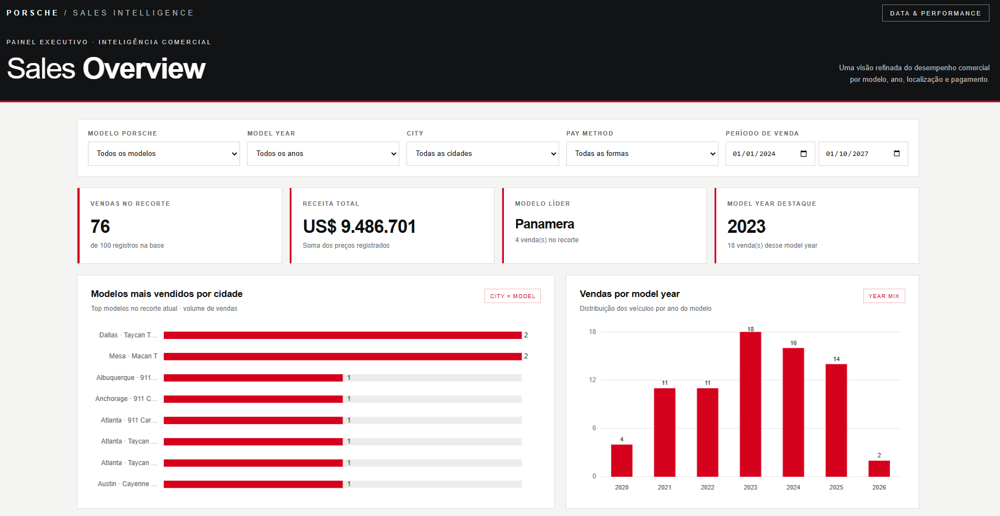
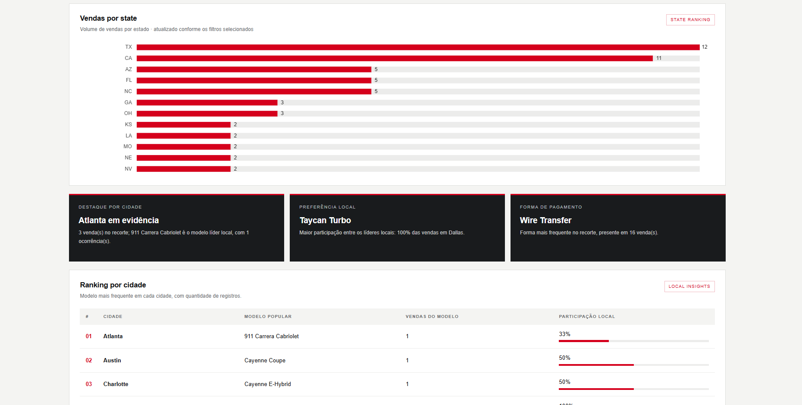
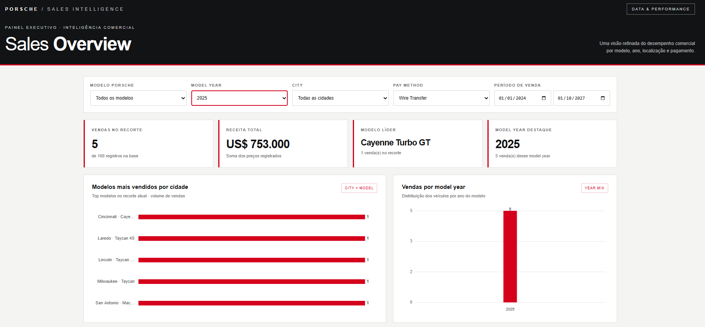

# Dashboard de Vendas Porsche

Dashboard interativo desenvolvido em HTML para análise de vendas de veículos Porsche, com foco na identificação de padrões comerciais, modelos mais vendidos e insights por cidade.

## Acesse a Dashboard

[**Visualizar Dashboard de Vendas Porsche**](https://anajuliaa9.github.io/dashboard-porsche-sales/)

## Objetivo

Analisar os dados de vendas de veículos Porsche por meio de uma dashboard interativa, facilitando a identificação dos modelos mais vendidos, a comparação entre cidades e a análise dos anos de modelo.

## Perguntas de Negócio

- **Quais são os principais modelos vendidos por cidade?** Para identificar preferências de consumo e diferenças entre mercados.
- **Qual ano de modelo apresenta maior volume de vendas?** Para identificar os anos de modelo com maior representatividade nas vendas.
- **Quais carros são mais populares em cada cidade?** Para reconhecer padrões locais de consumo e gerar insights que apoiem decisões comerciais.

## KPIs e Filtros

A dashboard permite explorar os dados por meio dos seguintes filtros:

- **Modelo:** seleção do modelo Porsche.
- **Model Year:** ano do modelo do veículo.
- **City:** cidade da venda.
- **Pay Method:** forma de pagamento.

Os filtros permitem segmentar as informações e analisar diferentes cenários de vendas.

## Desenvolvimento

### Prompt utilizado

O prompt utilizado para gerar a dashboard foi:

> Utilizando o recurso de Canvas, renderize uma dashboard em HTML ao lado.
>
> **Filtros**
> - Modelo da Porsche
> - Model Year
> - City
> - Pay Method
>
> **Perguntas de negócio e KPIs**
> - Quais os principais modelos de carro vendidos por cidade?
> - Qual o ano de modelo de carro que mais saiu em um período?
> - Quero insights de carros populares de vendas com base nos dados em cada cidade.
>
> Sobre UI/UX, use como referência o site oficial da Porsche Brasil: https://www.porsche.com/brazil/pt/
>
> A dashboard deve ter um visual elegante e refinado.

O prompt definiu os filtros, as perguntas de negócio e a direção visual da interface. O desenvolvimento foi realizado com o apoio do ChatGPT e do recurso Canvas, utilizando o site oficial da Porsche Brasil como referência de UI/UX.

### Tratamento dos Dados

A base de dados foi sanitizada com o auxílio de IA, utilizando um arquivo `schema.md` como referência. O tratamento envolveu a **padronização de campos e a correção de valores**, preparando os dados para sua utilização na dashboard.

## Tecnologias e Ferramentas

- **HTML:** estrutura da dashboard.
- **ChatGPT com Canvas:** apoio ao desenvolvimento da interface.
- **IA e `schema.md`:** apoio à sanitização e preparação dos dados.
- **GitHub:** versionamento e armazenamento do código-fonte.
- **GitHub Pages:** publicação da dashboard.

## Visualização do Projeto

### Dashboard

### Análise de Vendas

### Exemplo de Filtro Aplicado

Filtro selecionado: **Model Year 2025** e **Pay Method: Wire Transfer**, permitindo visualizar os resultados correspondentes a esses critérios.

## Acesse o Projeto

[**Clique aqui para acessar a Dashboard de Vendas Porsche**](https://anajuliaa9.github.io/dashboard-porsche-sales/)
